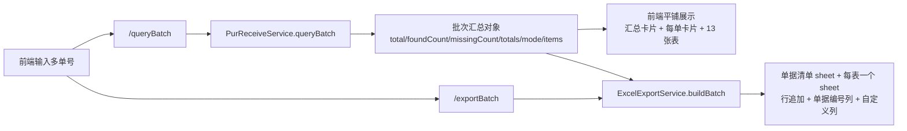

## 用户要求

多个采购收货单号以逗号分隔批量查询后，直接展示全部单据的数据与统计数量，不需要下拉选择单号，也不默认展示第一个查到的单据；同时调整后端批量查询接口，并同步调整批量导出。

## 产品概述

在采购收货单关联查询页中，一次输入多个单号即可得到一份完整的批次结果：顶部直接给出单号总数、查到数、未找到数以及明细、箱唛、附件、文件合计；所有单据按输入顺序依次平铺展示，每张单据的 13 张关联表数据全部可见，失败或未找到的单据单独标注原因。单号查询的原有展示方式保持不变。

## 核心特性

- 批量查询一次返回批次汇总信息（数量统计、数据源、全部单据结果），页面无需二次计算
- 页面直接平铺展示所有单据的数据，无选择控件、无默认选中第一个单据
- 顶部汇总卡片与逐单数量表格直接呈现查询出的数量
- 每张单据独立卡片展示主表信息与全部 13 张表数据，未找到的单据仅显示原因
- 批量导出按表合并：每张表一个工作表，多单据数据顺序追加并标识来源单据，保留失败单号说明
- 单号查询、单号导出及表级自定义列的行为保持不变

## Tech Stack Selection

沿用现有栈，不新增依赖：Java 8、Spring Boot 2.5.15、MyBatis、Apache POI 5.2.3、Lombok `@Data`、Jackson、JUnit 5 + MockMvc；前端 Vue 2.6 + Element UI 2.15（若依风格）。复用现有 `AjaxResult`、`GlobalExceptionHandler`、`BillNos`、`KingdeeProperties`、`PurReceiveSchema`、`DynamicTable`、`TableExportCustomizer` 等组件与约定。

## Implementation Approach

1. **批次汇总对象**：`PurReceiveService.queryBatch` 由返回裸数组改为返回 `LinkedHashMap` 批次结果，字段顺序固定为 `total / foundCount / missingCount / totals / mode / items`。`items` 仍是每个单号完整 dossier 的列表，逐单复用现有 `query()`；`totals` 对 `found=true` 的 `summary` 累加 `entryCount / boxCount / attachCount / fileCount`；`mode` 取自首个有效 dossier 的 `meta.mode`，无有效结果时回退到当前数据源配置。保持空输入、超上限、单号非法/未找到的部分失败语义不变。沿用项目现有的 Map 响应风格，不引入新 DTO 层，避免架构不一致。
2. **合并导出**：`ExcelExportService.buildBatch` 由「每单一组 `S1_`/`S2_` 工作表」改为「单据清单 sheet + 每张表一个 sheet」。按表汇总所有单据的 `rows`，按输入顺序追加；每个 sheet 末尾追加「单据编号」列以标识来源。技术上把工作表的行来源统一抽象为「一行数据 + 所属单据上下文」的内部轻量包装：单号导出与批量导出共用同一写表逻辑，批量时每行构造的 `RowExportContext.billNo/fid` 来自该行所属单据，确保表级自定义列仍逐行正确计算。「单据编号」列通过复用 `CustomColumn.of(...)` 追加到自定义列之后，不新增写表分支。
3. **前端平铺展示**：`handleQuery` 批量分支读取 `res.data.items` 与 `res.data` 汇总字段；删除 `activeBillNo` 及其下拉，`dossier` computed 在批量模式返回 `null`（不再取 `items[0]`），单号模式返回 `singleDossier`；数据源标签改用批次对象的 `mode`；`canExport` 批量时基于 `foundCount`；`exportJson` 批量时导出整个批次结果。模板改为「汇总卡片 + 逐单卡片」纵向平铺，逐单卡片用新增的 `sectionsOf(item)` 把 13 张表依次渲染为 `DynamicTable`；单号结果块、候选卡片、未找到提示增加 `!batchResults.length` 条件以隔离两种模式。
4. **兼容与取舍**：单号 `/query`、`/export` 返回结构零改动；批量上限 20、中英文逗号拆分、去重保序、部分失败标记保留；`BoxEntryExportCustomizer` 为用户自定义内容，禁止改动，测试不绑定其列文本。

## Implementation Notes

- 复用 `BillNos.parse`、`IllegalArgumentException` 由 `GlobalExceptionHandler` 输出 JSON、`AjaxResult.success`、`WorkbookUtil.createSafeSheetName`、`headerStyle` 单次创建复用、`displayLength` 列宽估算；所有单元格仍按文本写入，保持 19 位内码精度。
- 性能：批量 20 单 × 13 表，最坏情况单表行数可达 4 万行，需在实现中避免重复 `convertValue`（每行仅一次）并复用同一 `XSSFWorkbook`；汇总统计在遍历 items 时一次完成，复杂度 O(单据数 × 表数 + 总行数)，无额外查询或 N+1。
- 日志：沿用 slf4j 现有降级告警（自定义列取值失败每表最多一条），批量失败单号的信息放在响应 `message` 中，不打印整行数据。
- Blast radius：不改变单号接口、不改 `pom.xml`/`application.yml`/`db/*.sql`/`DynamicTable.vue`；`PurReceiveController` 仅更新注释说明返回结构；`ruoyi-ui/src/api/kingdee/receive.js` 仅更新注释。
- 验证：`ruoyi-ui/node_modules` 不存在，无法执行 `npm run build`；前端靠 IDE 静态诊断，后端靠完整 `mvn test` 回归。

## Architecture Design



## Directory Structure

```
project-root/
├── src/main/java/com/ruoyi/kingdee/
│   ├── service/
│   │   ├── PurReceiveService.java                 # [MODIFY] queryBatch 改为返回批次汇总对象：total/foundCount/missingCount/totals/mode/items；抽私有方法聚合 totals 与 mode；逐单查询与部分失败逻辑保持不变
│   │   └── ExcelExportService.java               # [MODIFY] buildBatch 改为按表合并工作表；新增「行 + 所属单据上下文」内部包装并统一 writeSheet 行遍历；批量时追加「单据编号」CustomColumn；保留单据清单 sheet；单号 build 路径不变
│   └── controller/
│       └── PurReceiveController.java             # [MODIFY] 仅更新 /queryBatch 与 /exportBatch 的注释说明新返回结构与合并工作表；接口路径与参数不变
├── src/test/java/com/ruoyi/kingdee/
│   └── PurReceiveIntegrationTest.java            # [MODIFY] 批量查询断言改为 $.data.total/foundCount/missingCount/totals/mode/items；批量导出断言改为按表合并的 sheet 数、行数、单据编号列与自定义列有效性；其余 11 个用例保持不变
└── ruoyi-ui/src/
    ├── api/kingdee/receive.js                    # [MODIFY] 更新 queryBatchReceive 注释，说明返回批次汇总对象
    └── views/kingdee/receive/index.vue           # [MODIFY] 删除下拉与 activeBillNo；dossier computed 批量返回 null；新增 batchResult/batchResults 状态与 sectionsOf 方法；重做批量结果区为汇总卡片 + 逐单平铺卡片；canExport/exportJson/modeType/isRealDb 适配批次对象；单号结果块增加模式隔离条件
```

不改动：`service/export/BoxEntryExportCustomizer.java`（用户自定义 INSERT SQL 列）、`TableExportCustomizer.java`、`CustomColumn.java`、`RowExportContext.java`、`util/BillNos.java`、`config/KingdeeProperties.java`、`application.yml`、`pom.xml`、`db/*.sql`、`DynamicTable.vue`、`utils/request.js`。

## Key Code Structures

`/queryBatch` 响应契约（`data` 为批次汇总对象，`items` 元素仍为现有完整 dossier）：

```
{
  "total": 2,
  "foundCount": 2,
  "missingCount": 0,
  "totals": { "entryCount": 3, "boxCount": 5, "attachCount": 3, "fileCount": 5 },
  "mode": "demo",
  "items": [ { "billNo": "...", "found": true, "tables": {}, "summary": {}, "meta": {} } ]
}
```

批量导出工作表契约：第 0 个 sheet 为「单据清单」（序号、单据编号、fid、是否找到、说明）；其后每个 sheet 名等于 `PurReceiveSchema` 表名，列顺序为「原列 + 该表自定义列 + 单据编号」，行按 items 顺序追加。

## 设计风格

沿用项目现有若依企业后台风格：浅灰背景、白色卡片、蓝色主色、细边框与轻阴影，信息密度优先，不做浮夸动效。批量结果区由「下拉选单号」改造为「汇总 + 全量平铺」，强调一眼看到数量与全部数据。

## 页面与区块（采购收货单关联查询页）

1. **搜索卡片**：保留单号输入（提示多个单号用逗号分隔）、模糊开关、查询/重置/导出结果按钮，以及导出范围选择与导出 Excel 按钮，样式与位置不变。
2. **批量汇总卡片**：标题含单据图标；摘要行直接展示共 N 个单号、查到 M、未找到 K、明细/箱唛/附件/文件合计，数字用主色加粗；下方紧凑表格逐单列出单号、状态标签、四类数量与失败说明。
3. **逐单数据卡片**：按输入顺序 `v-for` 渲染，每单一张卡片；标题显示单号、fid、状态标签与该单数量；找到的单据在卡片内按「表名小标题 + 行数 + 横向可滚动表格」平铺 13 张表，空表显示占位；未找到的单据仅显示原因说明。
4. **单号结果块**：保留现有统计卡片、主表描述与标签页，仅在批量模式下隐藏；候选列表与空结果提示同样按模式隔离。

## 交互与响应式

卡片纵向排列，表格支持横向滚动与表头固定；状态用绿/灰语义标签区分；桌面宽度优先，窄屏时摘要行自动换行、统计数字不截断。所有区块复用现有 `block-gap`、`card-header`、`sub-title`、`ext-block` 与 Element UI 组件，保持视觉一致。

## Agent Extensions

### SubAgent

- **code-explorer**
- Purpose: 实施前核对 `PurReceiveService.queryBatch`、`ExcelExportService.buildBatch`、`PurReceiveController` 两个批量接口、`index.vue` 当前下拉版本与 `PurReceiveIntegrationTest` 批量断言的最新状态，确认文件未被再次回退或改动。
- Expected outcome: 给出精确的待修改位置与需调整的断言清单（尤其 `$.data.length()` 改为 `$.data.items.length()`、导出 sheet 数与「单据编号」列断言），确保实施基于真实代码而非压缩上下文。