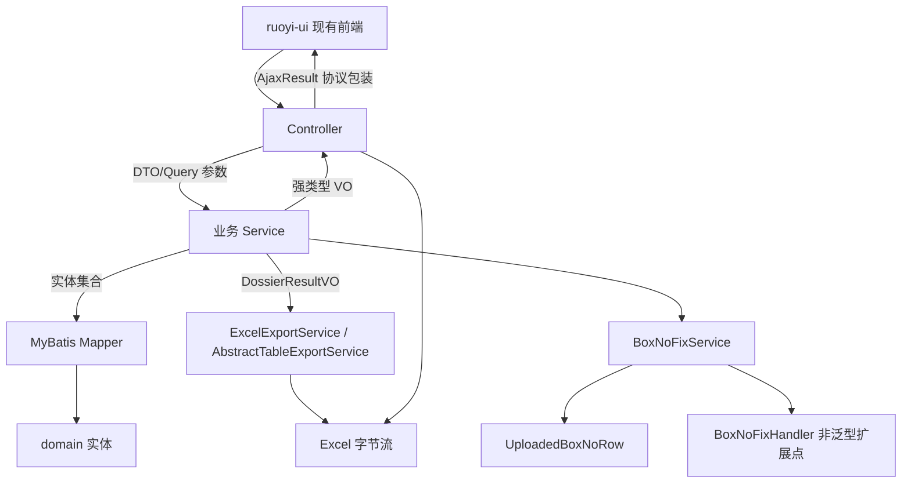

## 用户要求

检查并改造当前项目代码：非工具类接口中不允许出现通用接口或泛化契约，尤其是泛型接口、Map/Object 风格的参数和返回值；业务代码应低耦合、便于维护和修改；能使用实体类的位置优先使用实体类；补充并修正代码注释。

## 产品概述

本次改造面向后端查询、导出和箱号修正链路，不涉及页面视觉设计。目标是在不改变现有接口地址和前端 JSON 字段含义的前提下，把动态 Map 结构替换为明确实体、DTO 和 VO，并抽取重复逻辑，使后续调整单据字段、表结构或业务规则时改动范围更小。

## 核心功能

- 消除业务层通用接口：移除三个 Service 中的私有泛型接口，收敛 Map/Object 风格契约。
- 接口类型化：查询、批量查询、元数据和箱号修正请求使用明确的 DTO/VO/实体承载。
- 降低耦合：抽取公共档案组装、查询容错、Excel 响应写入和导出数据结构。
- 实体优先：数据库行继续使用现有 domain 实体，主键和外键尽量统一为明确类型。
- 注释完善：为公共类、接口、方法、字段及特殊例外补充中文注释，修正过期注释。
- 兼容验证：保持现有 URL 与 JSON 字段兼容，通过单元测试、集成测试和编译验证回归风险。

## Tech Stack Selection

沿用项目现有技术栈，不引入新框架：

- Java 8、Spring Boot 2.5.15
- Spring MVC、MyBatis
- Lombok
- Apache POI
- JUnit / Spring Boot Test
- Maven；用户环境编译时需使用 `mvn "-Dmaven.resolver.transport=wagon" -B -DskipTests clean compile`

## Implementation Approach

采用“接口契约冻结 → 类型模型补齐 → 业务逻辑组装下沉 → 导出与箱号链路类型化 → 测试验证”的渐进式重构。

关键决策：

1. **保持前端兼容**  
现有 `ruoyi-ui` 不改动。所有新增 VO 字段名与当前 `LinkedHashMap` 中的 key 保持一致，并按需使用 `@JsonPropertyOrder`、`@JsonInclude(NON_NULL)`，避免字段顺序和 null 字段造成接口差异。

2. **区分协议例外和业务契约**  
`common/AjaxResult` 继承 `HashMap<String,Object>` 是为了兼容若依 `{code,msg,data}` 响应协议，属于协议例外，可保留；但 `AjaxResult.success(...)` 中传入的 `data` 必须是明确 VO，不再是裸 Map。`util/`、`constant/` 中的通用能力可保留泛型工具方法，但不得把 Map 直接扩散为业务接口契约。

3. **实体、DTO、VO 分层明确**  

- `domain/`：继续使用现有数据库行实体承载 MyBatis 查询结果。
- `dto/`：承载入站查询条件和箱号修正请求。
- `vo/`：承载出站查询结果、表字典、汇总、明细扩展等组合结构。
- `service/export/`：承载导出专用强类型数据源，避免导出层读取字符串 key。

4. **移除泛型接口但允许工具层泛型**  
删除 `ExpressService`、`VehiclePlanService`、`PurReceiveService` 中各自的 `private interface SqlQuery<T>`。容错查询与分批查询 helper 统一下沉到 `util/QuerySupport`，仅在工具层使用 JDK 泛型能力；Service 中保留对具体实体集合的使用。

5. **降低重复逻辑**  
三个查询 Service 中重复的 `meta()`、`queryBatch()`、`putSection()`、`countNonEmpty()`、`safe()`、`finish()`、`bounds()` 等逻辑抽到公共 support 类。注意公共 support 不通过共享 Map 传递协议，而是接收/返回明确 VO。

6. **性能影响可控**  
改造不增加数据库查询次数。批量查询继续复用 `BillNos.parse`、`RowBounds` 和 `RowUtils.partition` 分批 IN 查询。VO 组装和批量汇总为 O(n)，导出反射字段读取应缓存 `Class` 到列访问器映射，避免每行重复反射解析。

## Implementation Notes

- 第一阶段先用 [subagent:code-explorer] 复核所有 Controller、Service、Mapper、测试及前端关键字段引用，产出“旧 JSON key → 新 VO 字段”映射表后再改代码。
- 修改 Service 返回类型时同步修改所有调用点和测试，避免中途出现 Map 与 VO 混用。
- 批量结果中的 `items` 建议声明为 `List<DossierResultVO>`；Jackson 按运行时子类序列化，可保留各业务 VO 的额外字段。
- 所有响应 VO 使用 Lombok `@Data`；必要时使用 `@JsonInclude(NON_NULL)` 省略当前 Map 未写入的可选字段。
- `fid`、`fentryid`、`fdetailid` 等 19 位内码统一按字符串边界处理，避免 JS 精度损失；Mapper SQL 使用 `#{}` 绑定字符串参数。
- 对 domain 中确实无法立刻确定的业务字段，不做盲目类型修改；应先依据 demo SQL、真实库字段和测试确认类型，再替换为 `String`、`Long`、`Integer`、`BigDecimal` 等明确类型。
- 保留现有日志级别与日志内容：`DataAccessException` 仍以 warn 记录，警告文案通过统一 support 生成，避免日志扩散和业务代码重复。
- 不改变现有接口路径、权限、HTTP 方法和 Excel 文件名规则。
- 编译验证必须使用 wagon 传输参数；如测试依赖 H2 demo 数据，先跑相关集成测试，再跑全量编译。

## Architecture Design



- Controller 只做请求绑定、调用 Service、包装响应和写 Excel 下载头。
- Service 负责查询编排和业务组装，不再手工拼接动态 Map。
- MyBatis Mapper 只接收明确参数类型并返回 domain 实体。
- 导出层消费强类型导出源，不再依赖 `found`、`tables`、`items` 等字符串 key。
- 箱号修正扩展点保持非泛型，但入参改为明确实体。

## Directory Structure Summary

本次改造新增 DTO/VO、公共 support 和导出源模型，修改现有 Controller、Service、Mapper、导出、箱号修正、实体字段、Schema 输出和测试。未列出的 `ruoyi-ui` 前端文件不改动。

```text
d:/project/kinde_erp/
├── src/main/java/com/ruoyi/kingdee/
│   ├── dto/                                      # [NEW] 入站请求模型目录
│   │   ├── BillQuery.java                        # [NEW] 通用单号查询条件：billNo、fid，封装原离散参数。
│   │   ├── BatchBillQuery.java                   # [NEW] 批量查询条件：billNos、table，集中解析与校验入口。
│   │   ├── PurReceiveQuery.java                  # [NEW] 收货单查询条件：billNo、fid、fuzzy，替代多参数组合。
│   │   └── FixBoxNoRequest.java                  # [NEW] 箱号修正请求：file、rowsJson，并负责转换为实体列表。
│   ├── vo/                                       # [NEW] 出站响应模型目录
│   │   ├── SchemaMetaVO.java                     # [NEW] 元数据响应：tables、relations、columnLabels、tableCount。
│   │   ├── TableDefVO.java                       # [NEW] 表定义响应，替换 TableDef.toMap 产生的动态字段。
│   │   ├── RelationVO.java                       # [NEW] 表关系响应，替换 Schema.relations 的 Map 结构。
│   │   ├── QueryMetaVO.java                      # [NEW] 查询元信息：queriedAt、elapsedMs、mode、tableCount。
│   │   ├── DossierSummaryVO.java                 # [NEW] 档案汇总：entryCount、boxCount、vehicleCount 等统计。
│   │   ├── TableSectionVO.java                   # [NEW] 表数据块：name、label、count、columns、rows、truncated。
│   │   ├── DossierResultVO.java                  # [NEW] 单档案响应基类：found、ambiguous、candidates、tables 等。
│   │   ├── ExpressDossierVO.java                 # [NEW] 采购物流单响应，增加 Express bill 与物流明细 entries。
│   │   ├── ExpressEntryVO.java                   # [NEW] 物流明细项：fentryid、fseq、row、ext、stats。
│   │   ├── ExpressEntryExtVO.java                # [NEW] 物流明细扩展关系，承载箱件信息子表集合。
│   │   ├── VehiclePlanDossierVO.java             # [NEW] 车辆计划响应，增加 VehiclePlan bill 与 entries。
│   │   ├── VehiclePlanEntryVO.java               # [NEW] 车辆计划明细项，替换手工 Map。
│   │   ├── VehiclePlanEntryExtVO.java            # [NEW] 车辆计划明细扩展关系。
│   │   ├── PurReceiveDossierVO.java              # [NEW] 收货单响应，增加 PurRecBill bill 与 entries。
│   │   ├── PurReceiveEntryVO.java                # [NEW] 收货明细项：row、ext、boxes、attachList、stats。
│   │   ├── PurReceiveEntryExtVO.java             # [NEW] 收货明细扩展关系：ENTRY_L、ENTRY_R、ENTRY_LK。
│   │   ├── PurReceiveAttachVO.java               # [NEW] 附件清单项：fdetailid、row、files。
│   │   ├── EntryStatsVO.java                     # [NEW] 明细统计：boxes、attachments、files 等可选字段。
│   │   ├── BatchResultVO.java                    # [NEW] 批量查询响应：total、foundCount、totals、items。
│   │   └── BatchTotalsVO.java                    # [NEW] 批量汇总：entryCount、boxCount 等合计字段。
│   ├── controller/
│   │   ├── ExpressController.java                # [MODIFY] 参数改为 DTO，返回 VO；抽出重复 Excel 响应写入。
│   │   ├── VehiclePlanController.java            # [MODIFY] 参数改为 DTO，返回 VO；抽出重复 Excel 响应写入。
│   │   └── PurReceiveController.java             # [MODIFY] 参数改为 DTO，返回 VO；修正重复注释和 rows 解析职责。
│   ├── service/
│   │   ├── ExpressService.java                   # [MODIFY] 用 VO 替换 Map 返回与内部组装；删除私有泛型接口。
│   │   ├── VehiclePlanService.java               # [MODIFY] 用 VO 替换 Map 返回与内部组装；删除私有泛型接口。
│   │   ├── PurReceiveService.java                # [MODIFY] 用 VO 替换 Map 返回与内部组装；拆分模糊查询语义。
│   │   ├── AbstractTableExportService.java       # [MODIFY] 抽象方法改为消费强类型 DossierResultVO/BatchResultVO。
│   │   ├── ExcelExportService.java               # [MODIFY] 收货单导出入口改为使用强类型查询结果。
│   │   ├── ExpressExcelService.java              # [MODIFY] 物流单导出入口改为使用强类型查询结果。
│   │   ├── VehiclePlanExcelService.java          # [MODIFY] 车辆计划导出入口改为使用强类型查询结果。
│   │   ├── BoxNoFixService.java                  # [MODIFY] 接收 UploadedBoxNoRow，修正错误注释。
│   │   └── support/
│   │       ├── DossierAssembler.java             # [NEW] 抽取表块构建、非空统计、查询元信息等公共组装逻辑。
│   │       └── BatchAssembler.java               # [NEW] 抽取批量查询汇总和单项失败包装逻辑。
│   ├── service/export/
│   │   ├── ExportDossierSource.java              # [NEW] 导出用单档案强类型数据源，替代 Map key 访问。
│   │   ├── ExportBatchSource.java                # [NEW] 导出用批量强类型数据源。
│   │   ├── ExportRow.java                        # [NEW] 导出行模型，按列顺序保存单元格文本和来源单号。
│   │   ├── RowExportContext.java                 # [MODIFY] 去掉 Map 行和 Object 内码，改为强类型上下文。
│   │   ├── TableExportCustomizer.java            # [MODIFY] 保持不变的非泛型扩展点，补充契约注释。
│   │   ├── ExpressExportCustomizer.java          # [MODIFY] 适配强类型列定义并返回明确 CustomColumn 集合。
│   │   ├── VehiclePlanExportCustomizer.java      # [MODIFY] 适配强类型列定义并返回明确 CustomColumn 集合。
│   │   └── BoxEntryExportCustomizer.java         # [MODIFY] 适配强类型列定义并返回明确 CustomColumn 集合。
│   ├── service/fix/
│   │   ├── UploadedBoxNoRow.java                  # [NEW] 上传 Excel 行实体：匹配键、箱号、原始字段。
│   │   ├── BoxNoFixHandler.java                   # [MODIFY] 保持非泛型，但入参改为 UploadedBoxNoRow。
│   │   ├── DefaultBoxNoFixHandler.java            # [MODIFY] 用实体字段替代动态 Map key，完善核心规则 TODO。
│   │   ├── BoxNoExcelSupport.java                 # [MODIFY] Excel 解析结果从 Map 改为 UploadedBoxNoRow。
│   │   ├── BoxNoExcelVo.java                      # [MODIFY] 补充字段与输出列注释，保持导出列兼容。
│   │   └── BoxNoFixRow.java                       # [MODIFY] 补充结果字段注释，必要时收敛 Object 字段。
│   ├── constant/
│   │   ├── ExpressSchema.java                     # [MODIFY] 保留常量职责，新增 VO 转换并废弃对外 toMap 使用。
│   │   ├── VehiclePlanSchema.java                 # [MODIFY] 保留常量职责，新增 VO 转换并废弃对外 toMap 使用。
│   │   ├── PurReceiveSchema.java                  # [MODIFY] 保留常量职责，新增 VO 转换并废弃对外 toMap 使用。
│   │   └── BoxNoColumnAliases.java                # [NEW] 集中箱号 Excel 列名别名，避免字符串中散落。
│   ├── mapper/
│   │   ├── vehicleplan/ExpressMapper.java         # [MODIFY] Object fid 改为 String fid，补充参数注释。
│   │   ├── vehicleplan/VehiclePlanMapper.java     # [MODIFY] fid/ids 改为 String/List<String>。
│   │   ├── receive/PurReceiveMapper.java          # [MODIFY] fid/ids 改为 String/List<String>。
│   ├── util/
│   │   ├── BillNos.java                           # [MODIFY] 保持工具职责，补充解析边界与校验注释。
│   │   ├── RowUtils.java                          # [MODIFY] 收敛 Object key 使用，输出明确 String key。
│   │   ├── QuerySupport.java                      # [NEW] 工具层泛型容错查询/分批查询，隔离通用能力。
│   │   └── ExcelResponseWriter.java               # [NEW] 统一 Excel 下载响应头，替换三个 Controller 重复代码。
│   ├── domain/
│   │   ├── BillCandidate.java                     # [MODIFY] fid 改为明确类型，作为候选单据类型化样板。
│   │   ├── Express.java                           # [MODIFY] fid 等 Object 字段按用途收敛为明确类型并注释。
│   │   ├── ExpressTc.java                         # [MODIFY] 收敛 Object 字段并补充字段含义。
│   │   ├── VehiclePlan.java                       # [MODIFY] 收敛 Object 字段并补充字段含义。
│   │   ├── VehiclePlanTc.java                     # [MODIFY] 收敛 Object 字段并补充字段含义。
│   │   ├── ContainerEntry.java                    # [MODIFY] 收敛 fentryid 等 Object 字段。
│   │   ├── Subentryentity.java                    # [MODIFY] 收敛 fentryid 等 Object 字段。
│   │   ├── VehicleEntry.java                      # [MODIFY] 收敛 Object 字段并补充字段含义。
│   │   ├── PurRecBill.java                        # [MODIFY] 收敛 fid 等 Object 字段。
│   │   ├── PurRecBillEntry.java                   # [MODIFY] 收敛 fentryid 等 Object 字段。
│   │   ├── PurRecBillEntryL.java                  # [MODIFY] 收敛 Object 字段。
│   │   ├── PurRecBillEntryLk.java                 # [MODIFY] 收敛 Object 字段。
│   │   ├── PurRecBillEntryR.java                  # [MODIFY] 收敛 Object 字段。
│   │   ├── PurRecBillF.java                       # [MODIFY] 收敛 Object 字段。
│   │   ├── PurRecBillL.java                       # [MODIFY] 收敛 Object 字段。
│   │   ├── PurRecBillLk.java                      # [MODIFY] 收敛 Object 字段。
│   │   ├── PurRecBillTc.java                      # [MODIFY] 收敛 Object 字段。
│   │   ├── PurRecBillWb.java                      # [MODIFY] 收敛 Object 字段。
│   │   ├── CgEntryAttachment.java                 # [MODIFY] 收敛 fdetailid 等 Object 字段。
│   │   ├── CgShEntryAttach.java                   # [MODIFY] 收敛 fdetailid 等 Object 字段。
│   │   └── ReceivingBoxEntry.java                 # [MODIFY] 收敛 fentryid 等 Object 字段。
│   └── common/
│       └── AjaxResult.java                        # [MODIFY] 补充协议例外说明，明确传入 data 必须为 VO。
├── src/main/resources/mapper/
│   ├── vehicleplan/ExpressMapper.xml              # [MODIFY] 保持 SQL 不变，验证 String 参数绑定。
│   ├── vehicleplan/VehiclePlanMapper.xml          # [MODIFY] 保持 SQL 不变，验证 String 参数与 ids 绑定。
│   └── receive/PurReceiveMapper.xml               # [MODIFY] 保持 SQL 不变，验证 String 参数与 ids 绑定。
└── src/test/java/com/ruoyi/kingdee/
    ├── ApiContractCompatibilityTest.java          # [NEW] 校验响应 JSON key、字段顺序和 null 省略策略。
    ├── BoxNoFixServiceTest.java                   # [MODIFY] 适配 UploadedBoxNoRow 与新的 Handler 入参。
    ├── ExpressUnitTest.java                       # [MODIFY] 适配 VO 返回和 String 内码。
    ├── PurReceiveIntegrationTest.java             # [MODIFY] 适配 VO、批量结果和箱号修正请求。
    ├── VehiclePlanIntegrationTest.java            # [MODIFY] 适配 VO 返回。
    └── VehiclePlanUnitTest.java                   # [MODIFY] 适配 VO 返回和公共 support。
```

## Agent Extensions

### SubAgent

- **code-explorer**
- Purpose: 复核 Controller、Service、Mapper、测试及前端字段引用，确认所有调用点和 JSON 契约。
- Expected outcome: 产出旧 Map key 到新 DTO/VO 字段的完整映射表，并标记不可破坏的兼容点。

### Skill

- **编程专家.Skill**
- Purpose: 对重构方案和执行结果做代码审查，检查低耦合、实体化、注释、测试与回归风险。
- Expected outcome: 输出可执行评审清单，确认无业务层泛型接口和裸 Map 契约残留，编译与测试通过。