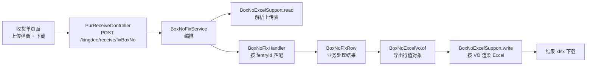

## 用户要求

修改「修改箱号信息」功能：点击按钮上传箱号信息 Excel 并由后端处理后，**导出结果 Excel 的数据改用专门的值对象（ExcelVo）承载**，不再由导出方法直接遍历原始 Map 取值。

## 产品概述

采购收货单页面的「修改箱号信息」功能在上传处理后，会导出一份「当前箱号信息 + 处理结果」的 Excel。本次改造把导出环节的数据载体独立出来：业务层产出的处理结果先转换为导出行值对象（ExcelVo），再由 Excel 写出工具按值对象渲染成表格。

## 核心功能

- **新增导出行值对象**：承载单行的「当前箱号信息各列文本值 + 正确箱号 + 处理说明 + 是否命中」四类信息，由业务结果一次性转换而来。
- **导出层与业务层解耦**：Excel 写出工具只依赖值对象写单元格，不再读取原始 Map、不再自行判断正确箱号的取值来源。
- **输出结果保持不变**：表头仍为「当前箱号信息列 + 正确箱号 + 处理说明」，列顺序与取值不变，已修正行浅黄、未匹配行浅红，单元格按文本写入。
- **行为不变**：接口地址与参数、返回文件名、前端上传与下载交互、按 `fentryid` 匹配的规则，以及留给业务方补充规则的 TODO 位置全部保持原样。


## 技术栈

沿用现有工程栈，**不引入新依赖**：

- 后端：Spring Boot 2.5.15 + MyBatis + JDK 8 + Lombok + POI 5.2.3（Excel 读写）+ Jackson
- 前端：Vue 2 + Element UI（本次无前端改动）

## 实现策略

采用「**业务结果 → 导出行 VO → Excel 写出**」三段式分层：

1. 业务层 `DefaultBoxNoFixHandler` 继续只负责匹配逻辑，产出 `BoxNoFixRow`（当前行 Map + 命中行 Map + 命中标记 + 说明）；
2. 新增 `BoxNoExcelVo` 作为**导出行值对象**，由静态工厂 `of(BoxNoFixRow)` 一次性完成「Map 值文本化 + 正确箱号取值 + 说明/标记复制」，把所有与业务语义相关的转换收敛到 VO 内部；
3. `BoxNoExcelSupport.write(...)` 改为只接收 `List<BoxNoExcelVo>`，按列名从 VO 取值写单元格、依据 `matched` 上色，**彻底不再感知 `BoxNoFixRow` 与原始 Map**；
4. `BoxNoFixService.fix(...)` 作为编排层，负责 `BoxNoFixRow → BoxNoExcelVo` 的转换后交给写出工具。

**关键决策与理由**：
- **值对象承载而非直接写 Map**：导出层与业务模型解耦后，后续若要调整导出列（增删列、改表头、换类型），只需在 VO 工厂或写出层调整一处，不会波及匹配逻辑；这与工程内既有 `AbstractTableExportService` 的分层思路一致（写出层只认列与值）。
- **VO 内 `values` 仍用 `Map<String, String>`**：当前箱号信息表的列是动态的（`tk_usp_receivingboxentry` 的列由 `SELECT *` 决定），无法用固定字段表达；因此以「列名 → 单元格文本」的有序 Map 承载，并在 VO 工厂统一完成 null → 空串、数值 → 文本的转换，**保证 19 位内码在 Excel 中不被转成科学计数**。
- **正确箱号取值逻辑上移**：原先散落在写出层的 `correctBoxNo(...)` 依赖 `DefaultBoxNoFixHandler.BOX_NO_KEYS` 与 `applied` Map，属于业务知识；上移到 VO 工厂后，写出层不再需要感知上传表的列名候选。
- **转换成本可忽略**：单次导出行数受限于当前查询的箱唛行数（后端单表限行 2000），VO转换是 O(行数 × 列数) 的纯内存字符串转换，与 POI 写单元格的开销相比可忽略，不引入额外 IO。

## 实施要点

### 1. 新增 `BoxNoExcelVo`（`service/fix` 包）
- 字段：`Map<String, String> values`（列名 → 单元格文本）、`String correctBoxNo`、`String message`、`boolean matched`；
- 静态工厂 `static BoxNoExcelVo of(BoxNoFixRow row)`：
  - 遍历 `row.getCurrent()`，值 `null` 转空串、其余 `String.valueOf(...)` 转文本，写入 `LinkedHashMap` 保持列序；
  - `correctBoxNo` 用 `DefaultBoxNoFixHandler.valueOfColumn(row.getApplied(), DefaultBoxNoFixHandler.BOX_NO_KEYS)` 取值（该方法大小写不敏感），取不到则空串；
  - `message`、`matched` 直接复制。
- 保持 `BoxNoFixRow` 不变：它是业务层（匹配）产物，VO 是导出层（渲染）产物，两者职责不同，不合并。

### 2. 改造 `BoxNoExcelSupport.write(...)`
- 签名由 `write(List<BoxNoFixRow>, List<String>, String)` 改为 `write(List<BoxNoExcelVo>, List<String>, String)`；
- 行循环内取值改为 `vo.getValues().get(column)`（缺列视为空串）、`vo.getCorrectBoxNo()`、`vo.getMessage()`，底色仍按 `vo.isMatched()` 选浅黄/浅红；
- **删除私有方法 `correctBoxNo(...)`**（逻辑已上移至 VO 工厂），同时删除因此不再被引用的 import；
- 表头常量 `CORRECT_BOX_NO_HEADER`、`MESSAGE_HEADER` 与配色常量保持原位，输出格式零变化。

### 3. 调整 `BoxNoFixService.fix(...)` 编排
- `handler.fix(...)` 得到 `List<BoxNoFixRow>` 后，映射为 `List<BoxNoExcelVo>`（调用 `BoxNoExcelVo::of`），再 `BoxNoExcelSupport.write(vos, columnsOf(currentRows), "箱号信息修正结果")`；
- `columnsOf(...)` 保持不变（仍以当前行 key 顺序作为表头列顺序）。

### 4. 测试
- 更新 `BoxNoFixServiceTest`：断言保持现有覆盖（按 `fentryid` 命中/未命中、大写表头容错、缺 `fentryid` 分支、表头列数、浅色底色）；
- 补一条针对 `BoxNoExcelVo.of(...)` 的单元断言：列值文本化（null → 空串）、`correctBoxNo` 取自上传行箱号列、无箱号列时为空串、`matched`/`message` 正确透传。

### 5. 不变更项（避免回归）
- 接口 `POST /kingdee/receive/fixBoxNo`（`file` + `rows`）、返回文件名与下载响应头；
- 前端按钮、上传弹窗、提交与下载逻辑；
- `BoxNoFixHandler` 接口与 `DefaultBoxNoFixHandler` 的匹配规则、`MATCH_KEYS`、`BOX_NO_KEYS` 及用户补业务规则的 TODO 位置。

## 架构设计



改造后，Excel 写出层只依赖 `BoxNoExcelVo`，业务层只产出 `BoxNoFixRow`，两者通过 VO 转换衔接。

## 目录结构

```
kinde_erp/src/main/java/com/ruoyi/kingdee/service/
├── fix/
│   ├── BoxNoExcelVo.java              # [NEW] 导出行值对象。字段：values（列名→单元格文本，LinkedHashMap 保序）、correctBoxNo、message、matched；
│   │                                  #静态工厂 of(BoxNoFixRow) 负责：当前行 Map 值文本化（null→空串）、正确箱号按 BOX_NO_KEYS 取值（找不到→空串）、
│   │                                  #       说明与命中标记透传。VO 只承载导出渲染所需数据，不含业务规则
│   ├── BoxNoExcelSupport.java         # [MODIFY] write(...) 签名改为接收 List<BoxNoExcelVo>，行循环改用 VO 取值与配色；
│   │                                  #           删除私有 correctBoxNo(...)及其不再使用的 import；read(...) 与常量、样式、列宽逻辑保持不变
│   ├── BoxNoFixRow.java               # [保持不变] 业务层匹配产物（current/applied/matched/message）
│   ├── BoxNoFixHandler.java           # [保持不变] 处理逻辑扩展点接口
│   └── DefaultBoxNoFixHandler.java    # [保持不变] 按 fentryid 匹配的默认实现与 TODO 位置
└── BoxNoFixService.java               # [MODIFY] fix(...) 编排增加 BoxNoFixRow → BoxNoExcelVo 映射后再调用 write；columnsOf 与参数校验保持不变

kinde_erp/src/test/java/com/ruoyi/kingdee/
└── BoxNoFixServiceTest.java           # [MODIFY] 保持既有匹配/底色/异常分支断言；补充 BoxNoExcelVo.of 的列值文本化、正确箱号取值、
 #          无箱号列为空串、matched/message 透传的断言
```

## 关键代码结构

```java
package com.ruoyi.kingdee.service.fix;

import lombok.Data;

import java.util.LinkedHashMap;
import java.util.Map;

/**
 * 箱号信息修正结果的导出行值对象：当前箱号信息各列文本 + 正确箱号 + 处理说明 + 命中标记。
 * 由 BoxNoFixRow 转换而来，是 Excel 写出层唯一依赖的数据结构。
 */
@Data
public class BoxNoExcelVo {

    /** 列名 → 单元格文本（保持列顺序） */
    private Map<String, String> values = new LinkedHashMap<>();
    /** 正确箱号（取自上传表命中行的箱号列，无则空串） */
    private String correctBoxNo;
    /** 处理说明 */
    private String message;
    /** 是否命中（决定底色：已修正浅黄、未匹配浅红） */
    private boolean matched;

    /** 由业务处理结果组装导出行值对象 */
    public static BoxNoExcelVo of(BoxNoFixRow row) {
        BoxNoExcelVo vo = new BoxNoExcelVo();
        if (row.getCurrent() != null) {
            for (Map.Entry<String, Object> entry : row.getCurrent().entrySet()) {
                Object value = entry.getValue();
                vo.getValues().put(entry.getKey(), value == null ? "" : String.valueOf(value));
            }
        }
        String boxNo = DefaultBoxNoFixHandler.valueOfColumn(
                row.getApplied(), DefaultBoxNoFixHandler.BOX_NO_KEYS);
        vo.setCorrectBoxNo(boxNo == null ? "" : boxNo);
        vo.setMessage(row.getMessage() == null ? "" : row.getMessage());
        vo.setMatched(row.isMatched());
        return vo;
    }
}
```

