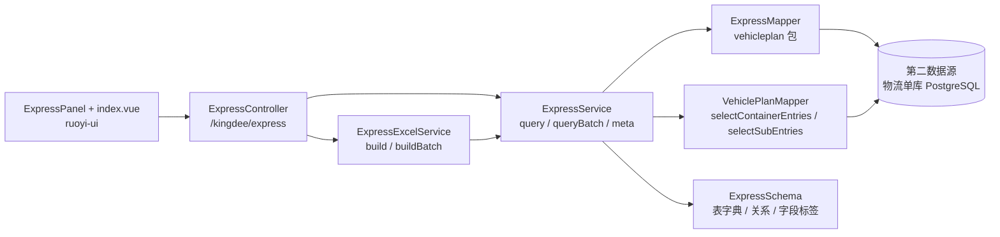

## 用户要求

仿照已有的「采购车辆计划查询」界面，新增一套「采购物流单查询」界面，数据依据用户提供的《采购物流单.drawio》ER 图（主表 `tk_usp_express`、关联追踪表 `tk_usp_express_tc`、物料明细 `tk_usp_container_entry`、箱件信息 `tk_usp_subentryentity`）。

## 产品概述

一个只读的采购物流单关联查询工具：输入物流单编号即可穿透「物流单主表 → 物料明细 → 箱件信息」两层关联键，把同一张物流单的承运信息、运输信息、发货物料与箱件明细集中呈现；也支持用逗号分隔多个单号一次性查询并合并成一份结果，结果可导出 Excel 便于线下核对。

## 核心功能

- **单号查询**：按单据编号（或主表内码）查询物流单档案；同一编号存在多条时给出候选列表供精确选择；单号非法时给出明确提示。
- **结果面板**：顶部统计卡（物料行数、箱件记录数、有数据的表数），主表卡片展示承运商、运输方式、出发地/目的地、交货地点与港口、提货单号、运输工具编号、公里数等核心信息，并展示关联链路。
- **分页签浏览**：物料信息（每行可展开查看所属箱号信息）、主表扩展（关联追踪表）、箱号信息（全部箱件记录，箱号等关键列前置）、全部表（各表折叠浏览）、关联关系（三条 ER 关系说明）。
- **批量查询**：逗号分隔多个单号，结果合并为一份展示，各表首列标注来源单据；未找到的单号单独提示。
- **导出**：导出 Excel（每张表一个工作表，批量导出时多单据数据追加到同一工作表并标注来源单据编号），也可导出查询结果 JSON。
- **视觉与交互**：完全沿用采购车辆计划查询页面的深色侧边栏 + Element UI 风格，菜单中新增「采购物流单查询」入口，顶部面包屑随页面标题切换。

## 技术栈

沿用现有工程栈，不引入新依赖：

- 后端：Spring Boot 2.5.15 + MyBatis（mybatis-spring-boot-starter 2.2.2）+ JDK 8 + POI 5.2.3（Excel）+ Lombok + PostgreSQL 驱动
- 前端：Vue 2 + Element UI + 自研 `DynamicTable` 展示组件（ruoyi-ui 独立脚手架）
- 数据库：物流单与采购车辆计划**共用第二数据源** `kingdee.vehicleplan.datasource`（PostgreSQL），只读连接池

## 实现策略

**新增 Express* 一套独立实现，复用车辆计划已有的数据资产**，不改动收货单与车辆计划的既有业务代码：

1. **复用**：`domain/ContainerEntry.java`（74 列全量）、`domain/Subentryentity.java`（18 列全量）两个实体直接复用（物流单 ER 图中这两张表与车辆计划为同表）；`VehiclePlanMapper.selectContainerEntries(fid)` / `selectSubEntries(ids)` 直接复用（同第二数据源、同 Mapper 包，SQL 固定表名 + `#{}` 绑定）；前端复用 `receive/DynamicTable.vue`、`receive/mergeDossier.js`。
2. **新增**：`Express`、`ExpressTc` 实体；`ExpressSchema` 字典；`ExpressMapper` + XML；`ExpressService`；`ExpressExcelService`；`ExpressController`；前端 `api/kingdee/express.js`、`views/kingdee/express/ExpressPanel.vue`、`views/kingdee/express/index.vue`；路由与侧边栏菜单项。
3. **主表精简、物料与箱件全量**：主表 32 列取白名单约 22 列（覆盖承运商、承运商联系人、司机电话、运输方式、出发地/目的地、交货地点、交货港口、提货单号、运输工具编号、公里数、供应商、采购组织、交货日期、单据类型、状态与创建修改审核信息），物料明细与箱件信息沿用既有全量实体。

## 关键技术决策

- **数据源与 Mapper 路由**：第二数据源配置类 `VehiclePlanDataSourceConfig` 上的 `@MapperScan("com.ruoyi.kingdee.mapper.vehicleplan", sqlSessionFactoryRef = "vehiclePlanSqlSessionFactory")` 已覆盖该包，因此 `ExpressMapper` **直接放入同一包**即可自动走物流单所在的库，无需第三个数据源、无需改动任何数据源配置类。
- **字段标签不重复维护**：`ExpressSchema.columnLabels()` 以 `VehiclePlanSchema.columnLabels()` 为基础合并物流单主表新增标签，避免再次抄写 74+18 个物料/箱件标签；容器与箱件表名常量同样引用 `VehiclePlanSchema.CONTAINER_ENTRY` / `SUB_ENTRY`。
- **单号白名单去重**：现有 `VehiclePlanService.validateBillNo` 为私有方法且与 `PurReceiveService` 重复。在 `util/BillNos` 新增 `public static void validate(String)`（长度不超过 64；仅允许字母、数字、汉字及 `. _ - /`），`ExpressService` 与 `VehiclePlanService` 共用；**收货单的 `PurReceiveService` 保持原样不动**，避免触碰已验证通过的逻辑，后续可单独统一。
- **dossier 契约与前端组件对齐**：返回结构与车辆计划完全同构（`found` / `ambiguous` / `candidates` / `message` / `billNo` / `fid` / `bill` / `tables` / `entries` / `summary` / `warnings` / `meta`），使 `ExpressPanel.vue` 可直接沿用车辆计划面板的 props（`hideBillCard`、`sourceColumn`）与 `mergeDossiers` 合并逻辑，批量视图首列来源单据标识天然可用。
- **无演示数据**：按用户确认不建 H2 演示表与样例数据，因此物流单接口不做集成测试，改用 Mockito 单元测试覆盖纯逻辑，真实库验证由用户手工完成。

## 性能与可靠性

- 查询链路固定为：主表按 `fbillno`（或 `fid`）定位 → 按 `fid` 查追踪表与物料明细 → 按物料明细 `fentryid` 集合批量查箱件信息；全部使用固定表名 + 参数绑定，无字符串拼接，无 SQL 注入面。
- 箱件信息查询沿用 `in-clause-batch-size`（500）分批与 `max-rows-per-table`（2000）限行；**物料明细为空时跳过箱件查询**，避免生成非法的 `IN ()` 条件。
- 单表查询失败按「降级为空分区 + warnings 提示」处理，不中断整份档案返回；日志仅记录表名与根因，不打印整行数据。
- Excel 导出单元格一律按文本写入，避免 19 位内码被转成科学计数丢失精度；单个自定义列取值异常写空值并按表去重告警，导出不中断。
- 导出为同步生成（数据量受限于单表 2000 行上限），批量导出多单据行合并写入同一工作表，避免工作表数量膨胀。

## 架构设计



## 目录结构

### 后端新增

```
kinde_erp/src/main/
├── java/com/ruoyi/kingdee/
│   ├── domain/
│   │   ├── Express.java                     # [NEW] 采购物流单主表实体。精简白名单约 22 列，字段名与数据库列名一致；@Data + @JsonInclude(NON_NULL)；ID 用 Object、numeric 用 BigDecimal、时间与文本用 String。覆盖：fid、fbillno、fbillstatus、承运商名称/联系人、司机电话、联系电话、运输方式、出发地、目的地、交货地点、交货港口、提货单号、运输工具编号、公里数、供应商、采购组织、交货日期、单据类型、创建/修改/审核人与时间
│   │   └── ExpressTc.java                   # [NEW] 采购物流单关联追踪表实体。7 列全量：fid、ftbillid、fttableid、fsbillid、fstableid、fsid、ftid；同样 @Data + @JsonInclude(NON_NULL)
│   ├── constant/
│   │   └── ExpressSchema.java               # [NEW] 物流单表字典。表名常量（EXPRESS=tk_usp_express、EXPRESS_TC=tk_usp_express_tc，容器/箱件常量引用 VehiclePlanSchema 以避免重复字面量）；4 个 TableDef（scope：主表与追踪表为 bill、容器明细为 entry、箱件为 custom）；relations() 三条关系；columnLabels() 以 VehiclePlanSchema.columnLabels() 为基础合并物流单主表标签；tableDef(name) 与 tableDefs()
│   ├── mapper/vehicleplan/
│   │   └── ExpressMapper.java               # [NEW] 物流单 Mapper 接口，与 VehiclePlanMapper 同包故自动走第二数据源。方法：selectExpressByBillNo(billNo, RowBounds)、selectExpressByFid(fid, RowBounds)、selectExpressTc(fid, RowBounds)；物料明细与箱件信息不重复定义，直接复用 VehiclePlanMapper 同名方法
│   ├── service/
│   │   ├── ExpressService.java # [NEW] 物流单查询服务。meta() 返回表字典/关系/字段标签；query(billNo, fid) 组装 dossier（found/ambiguous/candidates/message/billNo/fid/bill/tables/entries/summary/warnings/meta），entries 为物料明细行且每项含 row 与按 fentryid 分组的箱件信息 ext；queryBatch(billNos) 返回 total/foundCount/missingCount/totals/mode/items；单号白名单调用 BillNos.validate；物料为空时跳过箱件查询；表查询异常降级为空并写 warnings
│   │   ├── ExpressExcelService.java         # [NEW] 物流单 Excel 导出服务。与 VehiclePlanExcelService 同构：build(billNo, fid, table) 单据导出、buildBatch(billNos, table) 批量导出，每张表一个工作表、批量时多单据行顺序追加并在末尾追加「单据编号」列；表级扩展点通过 ObjectProvider<TableExportCustomizer> 按表名索引；单元格按文本写入
│   │   └── export/
│   │       └── ExpressExportCustomizer.java # [NEW] 物流单表级自定义列示例（如主表追加「运输路线」列），示范如何不改主流程即可调整导出列
│   └── controller/
│       └── ExpressController.java            # [NEW] 物流单查询接口。/kingdee/express 下 meta、query、queryBatch、export、exportBatch 五个接口；响应体沿用 AjaxResult（code/msg/data）；下载响应头沿用收货单/车辆计划写法
├── resources/mapper/vehicleplan/
│   └── ExpressMapper.xml                    # [NEW] 物流单 SQL。固定表名 + #{} 绑定：tk_usp_express 按 fbillno/fid 查询、tk_usp_express_tc 按 fid 查询；resultType 指向对应实体
```

### 后端修改

```
kinde_erp/src/main/java/com/ruoyi/kingdee/
├── util/BillNos.java                         # [MODIFY] 新增 static void validate(String)：长度不超过 64，仅允许字母/数字/汉字及 . _ - /，非法时抛 IllegalArgumentException；保持既有 parse/isMultiple 不变
└── service/VehiclePlanService.java           # [MODIFY] 私有 validateBillNo 改为委托 BillNos.validate，消除重复实现；查询、组装与批量逻辑保持不变，回归必须全绿
```

### 后端测试新增

```
kinde_erp/src/test/java/com/ruoyi/kingdee/
└── ExpressUnitTest.java                      # [NEW] 物流单纯逻辑单测。Mockito mock ExpressMapper 与 VehiclePlanMapper。覆盖：单号解析去重保序、非法字符拒绝、超过批量上限拒绝、批量中非法单据单独标记且不中断其他单据、summary 合计口径（物料行/箱件数/有数据表数）、重复单号时返回 ambiguous 候选
```

### 前端新增

```
kinde_erp/ruoyi-ui/src/
├── api/kingdee/
│   └── express.js                            # [NEW] 物流单接口封装。必须使用默认导入 import request from '@/utils/request'（utils/request.js 是 export default service，具名导入会报 Object(...) is not a function）。导出 getExpressMeta、queryExpress、queryExpressBatch、exportExpressExcel、exportExpressBatchExcel
└── views/kingdee/express/
    ├── ExpressPanel.vue                      # [NEW] 物流单结果面板。沿用车辆计划面板结构：4 张统计卡、主表卡片（含关联链路提示）、Tab 顺序为 物料信息（行内展开箱号信息）/ 主表扩展 / 箱号信息 / 全部表 / 关联关系（物流单无车辆明细 Tab）。复用 sectionOf、labelOf、widthOf、display、isEmpty、relationLabel、boxColumns 列前置逻辑；props 为 dossier、tableDefs、columnLabels、relations、hideBillCard、sourceColumn
    └── index.vue                             # [NEW] 物流单查询页。沿用车辆计划页面：单号与逗号批量分流查询、批量结果合并展示并标注来源单据、导出范围下拉（全部表/单表）、导出 Excel 与导出结果 JSON、错误提示与空状态
```

### 前端修改

```
kinde_erp/ruoyi-ui/src/
├── router/index.js                           # [MODIFY] 新增路由 /kingdee/express，组件指向 views/kingdee/express/index.vue，meta.title 为「采购物流单查询」、meta.icon 用 el-icon-truck；保留原有默认跳转与通配重定向
└── App.vue                                   # [MODIFY] 侧边栏「金蝶 ERP」分组下新增 el-menu-item index="/kingdee/express"，图标与文字为「采购物流单查询」；顶栏面包屑已按 $route.meta.title 动态显示，无需改动
```

## 关键代码结构

物流单查询服务对外契约（与采购车辆计划完全同构，保证前端组件可平移复用）：

```java
public Map<String, Object> query(String billNo, String fid);   // 单据档案 dossier
public Map<String, Object> queryBatch(String billNos);          // {total, foundCount, missingCount, totals, mode, items}
public Map<String, Object> meta();                              // {tables, relations, columnLabels, tableCount}
```

dossier 中 `entries` 每项的形状（前端 `ExpressPanel.vue` 直接消费）：

```java
{
  "fentryid": "物料明细行内码",
  "fseq": 1,
  "row": { /* ContainerEntry 全量字段 */ },
  "ext": { "tk_usp_subentryentity": [ /* Subentryentity 全量字段 */ ] },
  "stats": { "boxes": 2 }
}
```